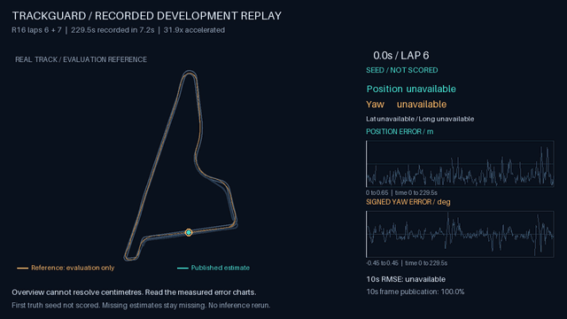
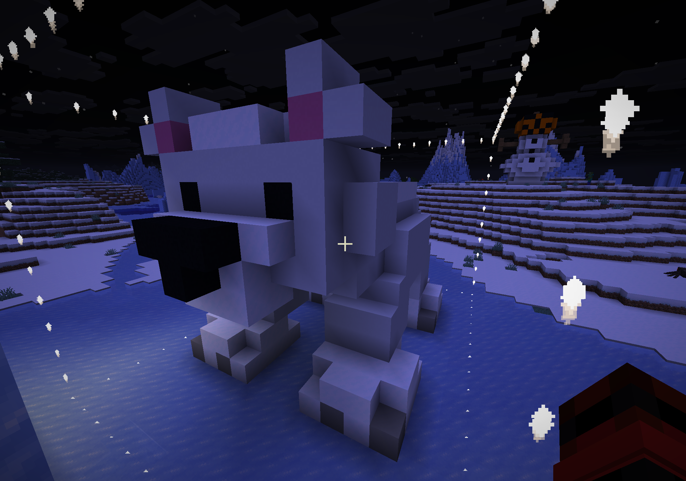

# Kende Daniel Rethelyi

Computer science student at KIT. I build AI tools and interactive software, and speak about AI in education.

[Portfolio](https://kendedanielrethelyi.de/) · [LinkedIn](https://www.linkedin.com/in/kende-daniel-rethelyi-b8647a363/)

## Selected work

  
  

| Project | What to explore | Status |
| --- | --- | --- |
| [TrackGuard](https://github.com/LivingPixel-pixel/trackguard-localization) | Camera-based vehicle localization, a recorded replay and error/availability evidence. Began as a hackathon team project. | Research prototype; reported accuracy is from same-session development laps. |
| [CraftGPT](https://github.com/LivingPixel-pixel/CraftGPT) | Describe a Minecraft build, inspect and revise the draft, then confirm placement. | v1.0.0 experimental prerelease. |
| [Climate Canopy](https://github.com/LivingPixel-pixel/climate-canopy) | A local-first climate journal with documented estimates, practical experiments and a symbolic garden. | Educational beta; estimates are not a certified inventory. |
| [AI-assisted mathematical research](https://github.com/LivingPixel-pixel/newman-polynomial-degree-obstructions) | A Newman-polynomial manuscript, exact certificates and reproducible verification tools. | AI research workflow with documented authorship and novelty limits. |

## How I work

I use AI tools for parts of implementation and review. My project notes distinguish team work, automated checks, observed behaviour and remaining validation.

For the mathematical research project, I initiated and supervised the workflow and selected outputs. The AI workflow produced the exploration, proofs, computation and manuscript. I did not independently derive every result. [Responsibility and workflow](https://github.com/LivingPixel-pixel/newman-polynomial-degree-obstructions/blob/main/docs/autonomous-research-workflow.md).

For project collaboration, internships or talk invitations, [get in touch](https://kendedanielrethelyi.de/#contact).
